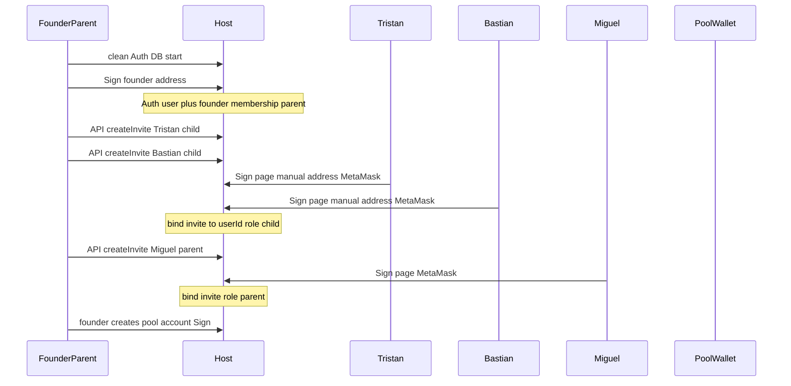
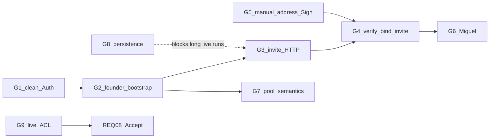

# Gap — Family onboarding (HTTP invite + Sign + founder/pool)

**UTC:** `2026-11-25T13:36:57Z`  
**Profile:** `capybara` · focus `capybara/`  
**Method:** analysis.mdc — Present = code/manuals/REQ on disk; Target = operator scenario (this wave); no invent implement  
**Operator scenario (process):** [`../manuals/FAMILY-ONBOARDING-OPERATOR-SCENARIO.md`](../manuals/FAMILY-ONBOARDING-OPERATOR-SCENARIO.md)

---

## 0. Intent

Оператор хочет end-to-end онбординг семьи на Railway host:

1. Почистить Auth DB (удалить тестового user) → чистый старт.  
2. Создать **founder** (Sign → Auth user + membership `parent`).  
3. С сервера создать **invite** детям (`TRISTAN_ADDRESS`, `BASTIAN_ADDRESS` из `.env`).  
4. На Sign-странице **вручную вставить address** → MetaMask Sign → invite accept → Auth user + role `child`.  
5. Затем invite + Sign для **Miguel** (`role=parent`).  
6. Затем как founder — **pool account** (Sign пула).

Этот документ: **Target vs Present vs Gap**. Docs alone ≠ implement. Unit green ≠ Done.

---

## 1. Target state (operator lock)

| Target seam | Requirement |
|-------------|-------------|
| Clean start | Delete existing Auth user(s) for retest (Admin API) |
| Founder first | Sign founder wallet → Auth user **and** family founder membership `parent` (UX: founder before late pool) |
| Invite API | Authenticated parent can `createInvite` over HTTP (Bearer) for known addresses + role |
| Sign UX | Page allows **human-entered** address (not only server-minted fixed address) |
| Invite accept | Sign/verify of invited address → `bindInviteeAndAccept` → membership with Invite.role + Auth `userId` |
| Co-parent | Same invite pattern with `role=parent` (Miguel after children) |
| Pool late | Founder can establish pool account/Sign after children (operator order) |
| Env | Children: `TRISTAN_ADDRESS`, `BASTIAN_ADDRESS`; Miguel address named for ops |

---

## 2. Present (verified code / docs)

### 2.1 Auth Sign → user (no family role)

| Seam | Fact | Path |
|------|------|------|
| `POST /auth/verify` | Challenge consume → `bindAddressToAuthUser` → Bearer session | [`../../host/authHttp.js`](../../host/authHttp.js) |
| Bind helper | Create/link Supabase Auth user only; **does not** write membership | [`../../packages/core/src/auth/bindAddressToAuthUser.js`](../../packages/core/src/auth/bindAddressToAuthUser.js) |
| Live bind Pass | REQ-09 Accepted `2026-11-25` — evidence | [`../manuals/evidence/live-supabase-auth-bind-result.md`](../manuals/evidence/live-supabase-auth-bind-result.md) |

### 2.2 Bootstrap (founder + pool together)

| Seam | Fact | Path |
|------|------|------|
| `POST /auth/bootstrap` | Requires **pool** + **parent** AddressProof in one call | [`../../host/authHttp.js`](../../host/authHttp.js) |
| Core | Creates family + founder membership `role=parent` + binds parent `userId`; `setPoolIdentity(familyId, poolAddress)` | [`../../packages/core/src/auth/bootstrapPoolAndFounder.js`](../../packages/core/src/auth/bootstrapPoolAndFounder.js) |
| Pool semantics | Logical pool identity on family — **not** an invite/membership role | same |
| Replay | Second bootstrap on live family → reject | same |

### 2.3 Invite (core Present · host Absent)

| Seam | Fact | Path |
|------|------|------|
| Invite modules | `InviteStore`, `createInvite`, `findOpenInviteByTo`, `bindInviteeAndAccept` | [`../../packages/core/src/invite/`](../../packages/core/src/invite/) |
| Gate in createInvite | DualAuthGate → RoleGate `family.members_settings`; bootstrapped family | [`../../packages/core/src/invite/createInvite.js`](../../packages/core/src/invite/createInvite.js) |
| Accept | Proof address must match Invite.`to`; role from Invite; Auth bind reused | [`../../packages/core/src/invite/bindInvitee.js`](../../packages/core/src/invite/bindInvitee.js) |
| Host HTTP `/invite*` | **Absent** | `host/` — no matches |
| Host runtime | `MembershipStore` in-memory in `createAuthRuntime`; **InviteStore not mounted** | [`../../host/authHttp.js`](../../host/authHttp.js) |
| verify → invite accept | **Absent** — verify does not call `bindInviteeAndAccept` | [`../../host/authHttp.js`](../../host/authHttp.js) |
| REQ-05 honesty | Railway host invite residual; opaque token Absent | [`../requirements/05-family-membership-parent-adds-child.md`](../requirements/05-family-membership-parent-adds-child.md) |

### 2.4 Sign page / mint

| Seam | Fact | Path |
|------|------|------|
| Mint | `POST /sign/mint` + mint secret + `body.address` → challenge locked to that address | [`../../host/signHttp.js`](../../host/signHttp.js) |
| HTML | Bootstrap embeds fixed `address`; **no** manual address input field | `renderSignPageHtml` in same file |
| Channels | REQ-10 Accepted; Channel A/B manuals Present | [`../requirements/10-wallet-address-proof-client.md`](../requirements/10-wallet-address-proof-client.md) |

### 2.5 Role gate / ACL

| Seam | Fact | Path |
|------|------|------|
| Probe | DualAuth → CatalogAlias → RoleGate on `/v1/capabilities/profile.self` | [`../../host/capabilityProbe.js`](../../host/capabilityProbe.js) |
| Role source | Membership only (client-claimed role ignored) | same + [`dualAuthGate.js`](../../packages/core/src/auth/dualAuthGate.js) |
| Live AC-I01/I02 | Unit Present; Railway evidence **Residual** | REQ-08 / IDENTITY §5.2 |

### 2.6 Env / addresses (as-is)

| Key | Fact |
|-----|------|
| `TRISTAN_ADDRESS` / `BASTIAN_ADDRESS` | Present in [`.env.example`](../../.env.example) |
| `MIGUEL_ADDRESS` | **Absent** from `.env.example` |
| `CAPY_POOL_ADDRESS` / `PARENT_ADDRESS` | Distinct fields (REQ-04); operator `.env` may hold **same hex** for both (as-is ops fact — do not paste secrets) |

### 2.7 Persistence

| Seam | Fact |
|------|------|
| MembershipStore / InviteStore / SignTokenStore / sessions | Process memory — redeploy clears (EDGE / INV residual) |

---

## 3. Gap table + backlog stories (REQ-level drafts `2026-11-25T13:44:45Z`)

**Decision locks (auto-accept UX/elegance/arch consistency):** **A1** — keep single bootstrap (dual Sign → one bootstrap); **B1** — pool identity at bootstrap only (no late pool API).

| ID | Target | Present | Gap | Story (REQ draft) |
|----|--------|---------|-----|-------------------|
| **G1** | Delete Auth user before retest | Admin list/create exercised · checklist Present ([`AUTH-USER-RETEST-CLEAN.md`](../manuals/AUTH-USER-RETEST-CLEAN.md)) | Live Admin delete/absence **Residual** this wave (not invented Pass) | [EDGE-07](../tasks/backlog-stories/capybara-identity-http-edge/STORY-SCR-CAPY-EDGE-07-auth-user-retest-clean.md) · tip pkg-000083 |
| **G2** | Founder-first UX | Bootstrap = pool+parent one call · A1 contract Present ([`FOUNDER-FIRST-DUAL-SIGN-BOOTSTRAP.md`](../manuals/FOUNDER-FIRST-DUAL-SIGN-BOOTSTRAP.md)) | Live MetaMask/remote bootstrap Pass not claimed (docs ≠ invent) | [AUTH-05](../tasks/backlog-stories/capybara-dual-auth/STORY-SCR-CAPY-AUTH-05-founder-first-dual-sign-bootstrap.md) **A1** · tip pkg-000084 |
| **G3** | HTTP createInvite | Core only | Host invite Absent | [INV-04](../tasks/backlog-stories/capybara-family-invite/STORY-SCR-CAPY-INV-04-host-http-create-invite.md) |
| **G4** | verify accepts invite | Auth-only verify | No bindInvitee on host | [INV-05](../tasks/backlog-stories/capybara-family-invite/STORY-SCR-CAPY-INV-05-host-verify-bind-invite.md) |
| **G5** | Manual address on Sign | Mint-fixed address | No typed address UX | [WPROOF-07](../tasks/backlog-stories/capybara-wallet-address-proof/STORY-SCR-CAPY-WPROOF-07-sign-manual-address-entry.md) |
| **G6** | Miguel co-parent after kids | Core `role=parent` | Host + env Absent | [INV-06](../tasks/backlog-stories/capybara-family-invite/STORY-SCR-CAPY-INV-06-coparent-miguel-env-scenario.md) |
| **G7** | Pool after children | Pool at bootstrap · B1 contract Present ([`POOL-AT-BOOTSTRAP-NO-LATE-API.md`](../manuals/POOL-AT-BOOTSTRAP-NO-LATE-API.md)) | Late pool API remains Absent (rejected B2) · scenario Step 5 = confirm | [AUTH-06](../tasks/backlog-stories/capybara-dual-auth/STORY-SCR-CAPY-AUTH-06-pool-at-bootstrap-no-late-api.md) **B1** · Done pkg-000085 · OPEN=0 |
| **G8** | Survive redeploy | In-memory | Durability Absent | [EDGE-08](../tasks/backlog-stories/capybara-identity-http-edge/STORY-SCR-CAPY-EDGE-08-membership-invite-survive-redeploy.md) |
| **G9** | Live ACL proof | Unit probe | Live evidence Absent | [EDGE-09](../tasks/backlog-stories/capybara-identity-http-edge/STORY-SCR-CAPY-EDGE-09-live-acl-profile-self-proof.md) |

---

## 4. Dependency of gaps (implement order hint — not a story scaffold)

Minimal path to operator browser scenario: **G3 + G4 + G5** (plus bootstrap path clarified under **G2**). G1 is ops. G6 follows G3/G4. G7 needs product decision vs Present bootstrap. G8/G9 honesty residuals.

---

## 5. Related (read-only pointers)

| Doc | Role |
|-----|------|
| [`../manuals/FAMILY-ONBOARDING-OPERATOR-SCENARIO.md`](../manuals/FAMILY-ONBOARDING-OPERATOR-SCENARIO.md) | Step process + Blocked-by G# |
| [`../requirements/04-dual-auth-wallet-supabase-user.md`](../requirements/04-dual-auth-wallet-supabase-user.md) | Dual-auth + bootstrap locks |
| [`../requirements/05-family-membership-parent-adds-child.md`](../requirements/05-family-membership-parent-adds-child.md) | Invite product AC · Railway residual |
| [`../requirements/08-identity-http-edge-on-host.md`](../requirements/08-identity-http-edge-on-host.md) | Edge + ACL (as-is stale until refresh) |
| [`../requirements/09-live-supabase-auth-port.md`](../requirements/09-live-supabase-auth-port.md) | Live Auth port Accepted |
| [`../requirements/10-wallet-address-proof-client.md`](../requirements/10-wallet-address-proof-client.md) | Sign channels Accepted |
| [`../manuals/IDENTITY-HTTP-EDGE-MANUAL.md`](../manuals/IDENTITY-HTTP-EDGE-MANUAL.md) | Host auth/bootstrap/probe ops |
| [`../manuals/WALLET-ADDRESS-PROOF-OPERATOR.md`](../manuals/WALLET-ADDRESS-PROOF-OPERATOR.md) | Mint / Channel A/B |

---

## 6. Non-claims / out of this analysis

- No host invite routes, Sign UI field, or verify wiring created by this doc.  
- No Auth user deleted in this docs wave.  
- No REQ Accepted / Phase 2 Done from this file.  
- Opaque invite token / `family.invite_member` RoleGate id / membership DDL persistence — still Absent per REQ-05 / Phase 3.  
- Private keys in `.env` — never copy into docs or commits.

---

## 7. Next (operator)

1. REQ-level stories Present for G1–G9 (see §3) — **Technical subtasks Present** on each story · **no implement** until focus dialog / P1.3.  
2. Recommended execute order: EDGE-07 → AUTH-05/06 → INV-04 → WPROOF-07 → INV-05 → INV-06 → EDGE-08 → EDGE-09.  
3. Live run: [`FAMILY-ONBOARDING-OPERATOR-SCENARIO.md`](../manuals/FAMILY-ONBOARDING-OPERATOR-SCENARIO.md).
