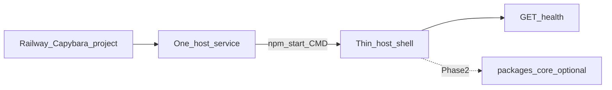

# Target technical architecture — Railway family host (Phase 1)

**UTC:** 2026-11-21T12:39:32Z  
**Profile:** `capybara` · focus `capybara/`  
**Slug:** `07-railway-family-host`  
**Mode:** system package (this overview + siblings)  
**Packaging pack:** applied (Git ownership ≠ image packaging)

## Context & inputs

| Input | Role |
|-------|------|
| [`../../requirements/07-railway-family-host.md`](../../requirements/07-railway-family-host.md) | Functional REQ (AC-H01…H06; topology MVP; host Absent) |
| Story scope | **none** (0 STORY files in this run) |
| Interview report | [`../../analysis/zeya888.target-tech-arch-interview-07-railway-family-host-2026-11-21.md`](../../analysis/zeya888.target-tech-arch-interview-07-railway-family-host-2026-11-21.md) |
| Sibling arch | [`../04-dual-auth-wallet-supabase-user/04-runtime-packaging-verify-env.md`](../04-dual-auth-wallet-supabase-user/04-runtime-packaging-verify-env.md) · [`../04-dual-auth-wallet-supabase-user/00-overview.md`](../04-dual-auth-wallet-supabase-user/00-overview.md) |
| Sibling REQ | [`04-…`](../../requirements/04-dual-auth-wallet-supabase-user.md) (live host residual → Phase 2) · ROADMAP Phase 1 |
| As-is | [`../../../package.json`](../../../package.json) (test/cli/compile only) · no Dockerfile/HTTP listen |

**Split:** REQ-07 stays product-facing (health OK, secrets, topology). This package is **how** thin host entry + packaging + verify sit on Railway — not NEW STORY/pkg/code.

**Functional vs tech:** AC-H* = product; `node:http` shell, Dockerfile, `npm start`, PORT = tech (interview).

## Target technical architecture of the focus

**Thin host shell + health** (interview DP1-B): one production process; Phase 1 serves `GET /health`; same entry later mounts Phase 2 auth edge (no DualAuth in Phase 1).

| Module (logical) | Responsibility |
|------------------|----------------|
| Thin host entry | `node:http` listen on `PORT`; route `/health` → 200 `{ ok: true }`; no secrets in body |
| Production start | `npm run start` → host entry (not CLI) |
| Packaging | Dockerfile + thin railway config; image ≠ unit-test proof |
| Railway | One project **Capybara** + one service (AC-H06) |

Siblings: [01-host-entry-and-health.md](./01-host-entry-and-health.md) · [02-packaging-and-ownership.md](./02-packaging-and-ownership.md) · [03-env-verify-deploy-residual.md](./03-env-verify-deploy-residual.md)

## Ownership / contracts (decided)

| Contract | Rule |
|----------|------|
| Source | Git (`capybara/` host entry + core) |
| Image | Railway build from Git — host entry + runtime deps; no baked secrets |
| Secrets / env | Railway variables (external); Phase 1 required: `PORT` |
| Topology | One project + one service MVP; per-family fleet later |
| Auth live | Phase 2 on **same** entry (REQ-04 residual) |
| Money keys | Not in browser/ChatGPT (AC-H05) |

## Runtime / packaging / verify / env / deploy-residual

See siblings. Summary: packaging pack **applied**; live proof = remote health; local `npm start` = residual ≠ Phase 1 Done; `npm test` alone ≠ Done (AC-H04).

## Coexistence with as-is

- CLI: [`package.json`](../../../package.json) `cli` script Present — operator coexistence.  
- HTTP server / Dockerfile: **Absent**.  
- AUTH/ROLE/INV/CAT modules Present in-process; Phase 1 gate does not require gated family calls.  
- Do not revive Express CRUD as product API (ROADMAP superseded).

## Open questions

- U1: Exact host entry path (`host/` vs `packages/host` — TBD implement; name ≠ create).  
- U2: Docker Node base image / version pin.  
- U3: Commit `railway.toml` vs dashboard-only + Dockerfile.

## Explicit Not in this doc

NEW STORY keys · NEW pkg · P3 · product code · Dockerfile stubs on disk · Railway MCP create as Done · DualAuth HTTP · MCP/Skill · invent multi-family fleet.
