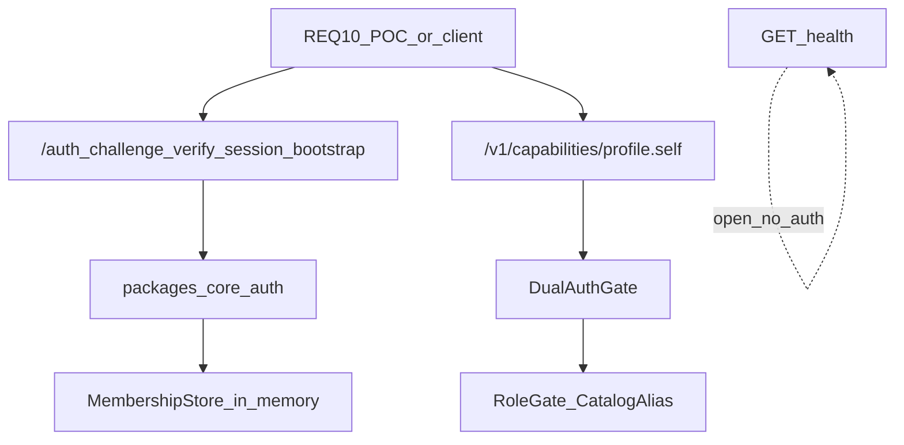

# Target technical architecture — Identity HTTP edge on host (Phase 2)

**UTC:** `2026-11-21T14:42:22Z`  
**Profile:** `capybara` · focus `capybara/`  
**Slug:** `08-identity-http-edge-on-host`  
**Mode:** system package (this overview + siblings)  
**Packaging pack:** reuse arch-07 (Git ownership ≠ image packaging already decided; no new image contract)

## Context & inputs

| Input | Role |
|-------|------|
| [`../../requirements/08-identity-http-edge-on-host.md`](../../requirements/08-identity-http-edge-on-host.md) | Functional REQ (AC-I01…I09; identity ops; pool/parent env; Connector CORS/domain pointers EDGE-11/12) |
| Story scope | **none** (0 STORY files in this run) |
| Interview report | [`../../analysis/zeya888.target-tech-arch-interview-08-identity-http-edge-on-host-2026-11-21.md`](../../analysis/zeya888.target-tech-arch-interview-08-identity-http-edge-on-host-2026-11-21.md) |
| Sibling arch | [`../07-railway-family-host/00-overview.md`](../07-railway-family-host/00-overview.md) · [`../04-dual-auth-wallet-supabase-user/00-overview.md`](../04-dual-auth-wallet-supabase-user/00-overview.md) · [`../06-role-scoped-capability-catalog/00-overview.md`](../06-role-scoped-capability-catalog/00-overview.md) |
| Sibling REQ (OOS / consume) | [`09-live-supabase-auth-port.md`](../../requirements/09-live-supabase-auth-port.md) · arch [`../09-live-supabase-auth-port/00-overview.md`](../09-live-supabase-auth-port/00-overview.md) · [`10-wallet-address-proof-client.md`](../../requirements/10-wallet-address-proof-client.md) · [`04-…`](../../requirements/04-dual-auth-wallet-supabase-user.md) · [`07-…`](../../requirements/07-railway-family-host.md) |
| As-is | [`../../../host/health.js`](../../../host/health.js) `/health` only · AUTH/ROLE Present under [`../../../packages/core/src/auth/`](../../../packages/core/src/auth/) · [`../../../packages/core/src/roleGate/`](../../../packages/core/src/roleGate/) |

**Split:** REQ-08 stays product-facing (unauth deny, ACL live, bootstrap proofs, manual). This package is **how** the same `npm start` process exposes `/auth/*` + capability probe and wires DualAuthGate→RoleGate — not NEW STORY/pkg/code.

**Functional vs tech:** AC-I* = product; router composition, `/auth` namespace, env keyMap, probe id `profile.self` = tech (interview auto UX/elegance).

## Target technical architecture of the focus

**Compose identity edge on thin host** (interview DP2-B): keep Phase 1 `/health`; add identity module composed into the same `node:http` server; in-process AUTH + RoleGate/CatalogAlias; MembershipStore **in-memory** for Phase 2 (redeploy residual).

| Module (logical) | Responsibility |
|------------------|----------------|
| Health | Unchanged `GET /health` — no auth, no secrets (AC-I05) |
| Identity HTTP module | Challenge, verify, session validate, logout, bootstrap — namespace `/auth/*` |
| Capability probe | Gated `profile.self` via DualAuthGate → RoleGate/CatalogAlias (AC-I01/I02) |
| Core AUTH/ROLE | Present modules; host wires, does not reimplement |
| Membership | In-memory MVP; persist = Phase 3 residual |

Siblings: [01-components-and-http-surface.md](./01-components-and-http-surface.md) · [02-bootstrap-session-and-capability-probe.md](./02-bootstrap-session-and-capability-probe.md) · [03-env-verify-coexistence-residual.md](./03-env-verify-coexistence-residual.md) · [04-connector-cors-and-challenge-origin.md](./04-connector-cors-and-challenge-origin.md) (EDGE-11/12 Nested tech)

## Ownership / contracts (decided)

| Artifact class | Owner |
|----------------|-------|
| Source (`host/` + `packages/core`) | Git |
| Runtime process | Railway service `host` (same as REQ-07) |
| Secrets | Railway / local `.env` — not Git |
| Membership rows (Phase 2) | Process memory |
| Supabase users | External (REQ-09 live port) |
| MetaMask POC / manual bodies | REQ-10 / stories (name ≠ create here) |

| Contract | Rule |
|----------|------|
| Session wire | `Authorization: Bearer` (AUTH transport Present) |
| URL namespace | `/auth/*` for identity ops; capability probe under `/v1/capabilities/…` |
| Probe capability | `profile.self` |
| Pool vs parent | `CAPY_POOL_ADDRESS` ≠ field `PARENT_ADDRESS` (values may equal) |
| Gate order | DualAuthGate before RoleGate/CatalogAlias |
| Login ≠ money | Unchanged ROADMAP invariant |

## Runtime / packaging / verify / env / deploy-residual

See [03-env-verify-coexistence-residual.md](./03-env-verify-coexistence-residual.md). Summary: **same** `npm start`; packaging **reuse** arch-07 (no new Docker contract); verify = unit wiring + live host/POC (AC-I06); Membership in-memory residual after redeploy.

## Coexistence with as-is

- Host `/health` Present — do not break AC-H01.  
- HTTP auth `/auth/challenge|verify` **Present** (EDGE Done); Soft≠Live historical «Absent» rows in early REQ §0 may lag.  
- Connector CORS + Origin→SIWE domain — Soft gap → [`04-…`](./04-connector-cors-and-challenge-origin.md) / EDGE-11/12.  
- Live Supabase port → REQ-09 Accepted.  
- Wallet Sign residual → REQ-10 / WPROOF-10 retire; Connector = target UX.  
- Do not revive Express CRUD family API (ROADMAP superseded).

## Open questions

- U1: Exact filenames under `host/` for identity module — stories / P1.3.  
- U2: Exact path suffixes under `/auth/` (e.g. `/auth/challenge` vs plural) — namespace locked; suffix TBD implement.  
- U3: Minimal JSON fields for probe success body — membership/role echo only; no invent beyond that.  
- U4: Whether bootstrap HTTP requires client-supplied `familyId` or host generates — Unknown → stories.

## Explicit Not in this doc

NEW STORY keys · NEW pkg · product code · REQ-09 `@supabase/supabase-js` body · REQ-10 MetaMask UI/POC files · journals→Supabase · MCP/Skill.
