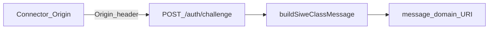

# 04 — Connector CORS + challenge Origin → SIWE domain/URI

**UTC:** `2026-11-27`  
**REQ:** [`../../requirements/08-identity-http-edge-on-host.md`](../../requirements/08-identity-http-edge-on-host.md) AC-I08/I09  
**Parent arch:** [`00-overview.md`](./00-overview.md) · HTTP surface [`01-components-and-http-surface.md`](./01-components-and-http-surface.md)  
**External SoT (Connector-owned):** [`../../../../doge-connector/docs/ops-platform-adapter-contract.md`](../../../../doge-connector/docs/ops-platform-adapter-contract.md) §3–§5 · integrator [`../../../../doge-connector/docs/manuals/platform-integrator-guide.md`](../../../../doge-connector/docs/manuals/platform-integrator-guide.md)  
**Stories:** EDGE-11 (CORS) · EDGE-12 (domain/URI)

**Lock:** Nested tech for Capybara adapter wave. Soft≠Live — this doc ≠ Live Pass. Do not invent second auth server. Keep `/auth/challenge|verify` contracts Present.

---

## 1. Verified as-is (Soft≠Live)

| Seam | Fact |
|------|------|
| `POST /auth/challenge` · `/auth/verify` | **Present** — [`../../../host/authHttp.js`](../../../host/authHttp.js) |
| Bodies | Compatible with Connector client (`challengeId` + `message` out; `{challengeId,signature}` in) |
| `Access-Control-*` under `capybara/host/` | **Absent** → browser Connector Origin blocked |
| SIWE defaults | [`../../../packages/core/src/auth/buildSiweClassMessage.js`](../../../packages/core/src/auth/buildSiweClassMessage.js) — `domain: capybara.local`, `uri: capybara://auth/challenge` — **wrong** for Connector flow |
| Same-origin Connector mock | Does not need CORS (PAUTH-08) — not a substitute for Capybara Live |

---

## 2. Target: CORS (EDGE-11)

Browser `platform-auth` from Connector page → Capybara must allow Connector **signing origin**.

| Launch surface | Example `Origin` | Allow |
|----------------|------------------|-------|
| Local Connector | `http://127.0.0.1:8080` · `http://localhost:8080` | Exact origin (dev) |
| Railway / HTTPS Connector | `https://<connector-host>` | Exact HTTPS origin |

| Item | Rule |
|------|------|
| `Access-Control-Allow-Origin` | Echo allowed Origin (not `*`) |
| `Access-Control-Allow-Methods` | at least `POST`, `OPTIONS` |
| `Access-Control-Allow-Headers` | at least `Content-Type`, `Accept` |
| Preflight | `OPTIONS` on `/auth/challenge` and `/auth/verify` → 204/200 |
| Unknown Origin | Fail-closed (no wildcard invent) |

Wire in host identity HTTP path (`authHttp.js` / server composition) — detail Nested T in EDGE-11.

---

## 3. Target: Origin → SIWE domain/URI (EDGE-12)

| Topic | Rule for Connector flow |
|-------|-------------------------|
| What is signed | Exact UTF-8 `message` from challenge — not bare `challengeId` |
| **domain** | Host of Connector signing Origin (page that opened MetaMask) |
| **URI** | Absolute origin (or origin URL) of that Connector page |
| Forbidden for Connector flow | `capybara.local` · `capybara://auth/challenge` |

Pass Origin (or derived domain/URI) into `issueChallenge` / `buildSiweClassMessage` — Nested T in EDGE-12. Cite as-is defaults Present until implement.

---

## 4. Story split

| Key | Owns |
|-----|------|
| EDGE-11 | CORS allowlist + OPTIONS + fail-closed |
| EDGE-12 | Origin→domain/URI · refuse wrong defaults for Connector |

Order: CORS → domain/URI (integrator guide). Soft depends EDGE-12 on EDGE-11.

---

## 5. Non-goals

- Connector `CONNECTOR_PLATFORMS` whitelist (Connector ops)  
- Sign `/sign/*` retire (WPROOF-10 / arch-10/`05`)  
- Invent full EIP-4361 `Chain ID`  
- Claim Live MetaMask verify Pass from this arch alone  
- Materialize epic trees in docs-only wave (`name≠create`)
