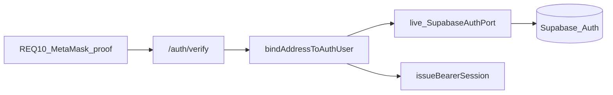

# Target technical architecture — Live Supabase Auth port (Phase 2)

**UTC:** `2026-11-24T13:17:11Z`  
**Profile:** `capybara` · focus `capybara/`  
**Slug:** `09-live-supabase-auth-port`  
**Mode:** system package (this overview + siblings)  
**Packaging pack:** applied (Git ownership ≠ image packaging — `@supabase/supabase-js` must ship in host image)

## Context & inputs

| Input | Role |
|-------|------|
| [`../../requirements/09-live-supabase-auth-port.md`](../../requirements/09-live-supabase-auth-port.md) | Functional REQ (AC-S01…S05; live bind after address proof) |
| Story scope | **none** (0 STORY files in this Architect run) |
| Related Done story (cite only) | [`../../tasks/backlog-stories/capybara-dual-auth/STORY-SCR-CAPY-AUTH-02-supabase-user-session.md`](../../tasks/backlog-stories/capybara-dual-auth/STORY-SCR-CAPY-AUTH-02-supabase-user-session.md) — modules + memory double Present; live residual |
| Interview report | [`../../analysis/zeya888.target-tech-arch-interview-09-live-supabase-auth-port-2026-11-24.md`](../../analysis/zeya888.target-tech-arch-interview-09-live-supabase-auth-port-2026-11-24.md) |
| Sibling arch | [`../04-dual-auth-wallet-supabase-user/00-overview.md`](../04-dual-auth-wallet-supabase-user/00-overview.md) · [`../04-dual-auth-wallet-supabase-user/04-runtime-packaging-verify-env.md`](../04-dual-auth-wallet-supabase-user/04-runtime-packaging-verify-env.md) · [`../08-identity-http-edge-on-host/00-overview.md`](../08-identity-http-edge-on-host/00-overview.md) · [`../07-railway-family-host/00-overview.md`](../07-railway-family-host/00-overview.md) · [`../10-wallet-address-proof-client/00-overview.md`](../10-wallet-address-proof-client/00-overview.md) |
| Sibling REQ | [`08-…`](../../requirements/08-identity-http-edge-on-host.md) · [`10-…`](../../requirements/10-wallet-address-proof-client.md) (**Accepted**) · [`04-…`](../../requirements/04-dual-auth-wallet-supabase-user.md) · [`07-…`](../../requirements/07-railway-family-host.md) |
| As-is | [`../../../packages/core/src/auth/supabaseAuthPort.js`](../../../packages/core/src/auth/supabaseAuthPort.js) residual throw · [`bindAddressToAuthUser.js`](../../../packages/core/src/auth/bindAddressToAuthUser.js) · host default memory [`../../../host/authHttp.js`](../../../host/authHttp.js) |

**Split:** REQ-09 stays product-facing (live Auth bind, fail-closed, secrets, unit≠Done). This package is **how** the live port create/links users and how production host selects it — not NEW STORY/pkg/code.

**Level:** Mixed functional+tech · packaging theme pack mandatory.

## Target technical architecture of the focus

Replace production use of `createLiveSupabaseAuthPortResidual()` with a real `SupabaseAuthPort` backed by `@supabase/supabase-js` Admin Auth API. After REQ-10 address proof, `/auth/verify` already calls `bindAddressToAuthUser` → port `createOrLinkUser`; live port must return a real Supabase `userId`.

| Module (logical) | Responsibility |
|------------------|----------------|
| Live `SupabaseAuthPort` | `createOrLinkUser(proof)` via Admin API; `kind: live-supabase-js`; `residual: false` |
| Memory double | Unit tests only (unchanged contract) |
| Residual factory | Must not remain production host wiring after implement (AC-S01) |
| Host `createAuthRuntime` | Config Present → live port; missing config → fail-closed; no silent memory when config Present |
| Bind helper | Unchanged consumer of port |

Siblings: [`01-port-contract-and-bind.md`](./01-port-contract-and-bind.md) · [`02-host-wiring-env-fail-closed.md`](./02-host-wiring-env-fail-closed.md) · [`03-packaging-verify-deploy-residual.md`](./03-packaging-verify-deploy-residual.md).

## Ownership / contracts (interview locks)

| Artifact | Ownership |
|----------|-----------|
| Port source | Git (`packages/core`) |
| `@supabase/supabase-js` | Git lockfile + **image** via workspace install |
| Supabase project / users | External (Supabase) |
| Secrets (`SUPABASE_*`, `CAPY_BEARER_SECRET`) | Railway env — never Git / never `/health` |
| Sessions / MembershipStore | Process memory (Phase 2 residual — not this REQ) |

## Runtime / packaging / verify / env / residual

See siblings **02** and **03**. Production start remains `npm start` (same host as REQ-07/08/10).

## Coexistence with as-is

| Seam | Today | Target |
|------|-------|--------|
| Live port body | Residual throw | Working Admin create/link |
| Host default `authPort` | Always memory double | Live when auth env config loads |
| Unit tests | Memory double | Unchanged |
| HTTP routes | REQ-08 Present | Unchanged (OOS this REQ) |

## Open questions

1. Ops: which Supabase project is prod for Capybara (not arch invent).  
2. Exact Supabase duplicate-user error string — resolve at implement against SDK.  
3. Optional future email-domain env override — **out of MVP** (fixed `@capybara.local`).

## Explicit “Not in this doc”

- NEW STORY / pkg / P3 / work-item lists  
- Product code  
- Journals / membership DDL (Phase 3)  
- Address rebind · MCP/Skill · wallet UI  
