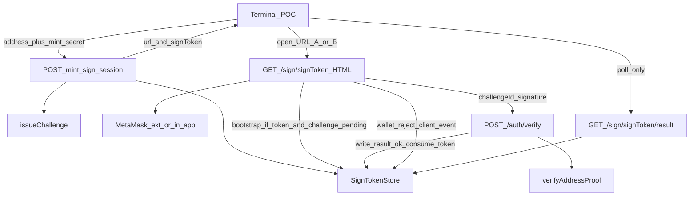

# Target technical architecture — Wallet address-proof client (Phase 2)

**UTC:** `2026-11-23` · **rev:** validator FAIL wave3 `/result` transitions  
**Profile:** `capybara` · focus `capybara/`  
**Slug:** `10-wallet-address-proof-client`  
**Mode:** system package (this overview + siblings)

## Context & inputs

| Input | Role |
|-------|------|
| [`../../requirements/10-wallet-address-proof-client.md`](../../requirements/10-wallet-address-proof-client.md) | Functional REQ (AC-W01…W09; dual channel; unique-token URL) |
| Crypto note | [`../../analysis/analysis-wallet-personal-sign-crypto-2026-11-23.md`](../../analysis/analysis-wallet-personal-sign-crypto-2026-11-23.md) |
| Gap note | [`../../analysis/analysis-wallet-personal-sign-client-gap-2026-11-23.md`](../../analysis/analysis-wallet-personal-sign-client-gap-2026-11-23.md) |
| Host edge | [`../08-identity-http-edge-on-host/00-overview.md`](../08-identity-http-edge-on-host/00-overview.md) — `/auth/challenge|verify` Present |
| Core | [`../../../packages/core/src/auth/`](../../../packages/core/src/auth/) — SIWE-class message + `ethers.verifyMessage` |

**Split:** REQ-10 = product locks. This package = **how** the minimal signing page + token URL + dual channels attach to Present host without inventing a second auth server.

**Not this package:** NEW STORY files until OP approve of story proposal · MCP tool body (ROADMAP **Phase 4**) · runtime code.

**Delivery-plan phases (do not confuse with ROADMAP Phase 4):** see [`03-story-coverage-gate.md`](./03-story-coverage-gate.md) — D1 REQ · D2 arch/crypto · D3 story proposal · D4 materialize stories · D5 implement.

## Target picture

### Who creates what

| Step | Actor | Creates / returns |
|------|--------|-------------------|
| Mint | `POST` mint (path TBD in stories; **not** a change to `/auth/verify` body) | `issueChallenge` + `signToken`→`challengeId`; `{ signToken, url, challengeId, expiresAt }` |
| Page load | `GET /sign/{signToken}` | **HTML** with embedded bootstrap JSON — only if token active **and** challenge still pending ([`02-…`](./02-channels-and-sign-token.md)) |
| Sign | Page + MetaMask | `signature` hex per [`01-…`](./01-personal-sign-and-verify.md) |
| Verify | Unchanged `POST /auth/verify` `{ challengeId, signature }` | EDGE verify JSON to page |
| On verify success | Same host path | Consume challenge → **write `result=ok`** → mark token consumed for HTML ([`02-…`](./02-channels-and-sign-token.md)) |
| Wallet reject | Page may `POST /sign/{signToken}/client-event` `{ "type":"wallet_reject" }` | **Does not** change `/result` to a terminal status; page shows cancel; **retry same mint** while token+challenge pending |
| POC learn host OK | **Only** poll `GET /sign/{signToken}/result` | See table below |

**Model lock:** `signToken` **only opens** the challenge for the page. Verify body has **no** `signToken`. After successful verify, challenge is spent (login SoT); URL must fail-closed on re-open even if token mark glitches ([`02-…`](./02-channels-and-sign-token.md)).

### Terminal POC result contract (single mechanism)

POC, after mint, **only** polls `GET /sign/{signToken}/result` (`Cache-Control: no-store`), using **that mint’s** `signToken`. No page→POC callback, no paste, no alternate poll of verify.

**Terminal for POC:** only host **`ok`** (success) or fail-closed (exit ≠ 0). MetaMask cancel is **not** terminal.

**Fail-closed (exit ≠ 0):** POC stops on the **first** of: (a) local poll timeout (default ≤ challenge TTL, e.g. 5 min) **or** (b) HTTP 4xx/gone from `/result` (unknown token / past `expiresAt` / no session). Whichever arrives first ends the run; do not wait for the other.

| `status` / HTTP | Meaning | POC |
|-----------------|---------|-----|
| `pending` | Session open; verify not succeeded — **includes** after `wallet_reject` | Keep polling |
| `ok` | Host accepted verify and wrote result; residual-safe fields (`challengeId`, `address`); **no** bearer dump. Readable until sign-session `expiresAt` even after HTML token consumed | Print OK; exit 0 |
| 4xx/gone (unknown / past `expiresAt` / no session) | Session expired or unknown | exit ≠ 0 (**fail path b**) |
| Local timeout (no `ok` yet) | Cancel-only / stuck / result-write-fail left `pending` | exit ≠ 0 (**fail path a**) |

**Precedence:** server `ok` always wins over any client-event. After `ok`, further client-events are no-op. Parallel tabs: reject in one + verify success in another → POC sees `ok`.

**Phase 2:** status `failed` is **not** written from `wallet_reject` (not used for MetaMask cancel).

Mint fail (`CAPY_PUBLIC_BASE_URL` / mint secret / bad address) → exit ≠ 0 before open URL. New mint only after session expiry / POC timeout / need new challenge — not after a cancel that still has live token+challenge.

## Piece table

| Piece | Responsibility |
|-------|----------------|
| Host `/auth/challenge|verify` | Unchanged contracts (EDGE Present) |
| Mint + SignTokenStore + `/result` + `client-event` | Token URL, HTML gate, POC status ([`02-…`](./02-channels-and-sign-token.md)) |
| Sign page | HTML bootstrap → Connect → `personal_sign` → verify / client-event ([`01-…`](./01-personal-sign-and-verify.md)) |
| Terminal POC | Mint → open/print URL → **poll `/result` only** → OK (AC-W06) |
| Manual / matrix | Both channels (AC-W07/W08) |

## Sibling docs

| Doc | Path |
|-----|------|
| Crypto encoding + client UX | [`01-personal-sign-and-verify.md`](./01-personal-sign-and-verify.md) |
| Channels + token URL | [`02-channels-and-sign-token.md`](./02-channels-and-sign-token.md) |
| Story coverage gate | [`03-story-coverage-gate.md`](./03-story-coverage-gate.md) |
| POC debug + bootstrap assist (REQ-11) | [`04-poc-debug-surface-and-bootstrap-assist.md`](./04-poc-debug-surface-and-bootstrap-assist.md) |

## Explicit OOS

MCP/Skill URL handoff **body** (ROADMAP Phase 4) · ChatGPT in-app browser as sole channel · server `personal_sign` · ERC-1271 · invent new SIWE from scratch · EDGE package stories · requiring `signToken` inside `/auth/verify` body · alternate POC result channels (callback/paste).
