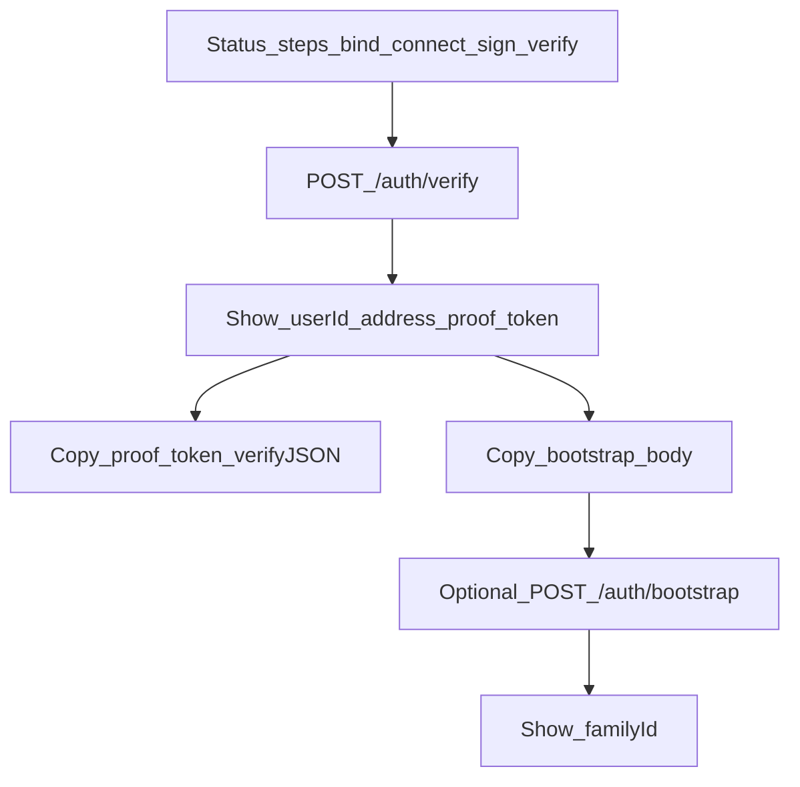

# 04 — Sign POC debug surface + founder bootstrap assist

**UTC:** `2026-11-26T10:25:00Z`  
**REQ:** [`../../requirements/11-sign-poc-debug-and-family-api-path.md`](../../requirements/11-sign-poc-debug-and-family-api-path.md)  
**Parent arch:** [`00-overview.md`](./00-overview.md) · encode [`01-personal-sign-and-verify.md`](./01-personal-sign-and-verify.md) · token [`02-channels-and-sign-token.md`](./02-channels-and-sign-token.md)  
**Bootstrap consumer:** [`../04-dual-auth-wallet-supabase-user/03-bootstrap-pool-and-founder.md`](../04-dual-auth-wallet-supabase-user/03-bootstrap-pool-and-founder.md) · invite HTTP [`../05-family-membership-parent-adds-child/01-invite-and-pending-membership.md`](../05-family-membership-parent-adds-child/01-invite-and-pending-membership.md)

**Lock:** Same-host `/sign/{signToken}` POC only — **no** separate Sign origin. Target wallet UX later = DOGEstonia Connector. Do not invent DDL or durable proof store.

---

## 1. Problem (verified)

After `POST /auth/verify` success, host JSON includes `proof`, `token`, `userId`, `address` (and optional invite fields). Inline Sign client sets status to `Verified. Address: …` and **does not surface** those fields — operator needs DevTools. One-shot mint then returns `ESIGN_TOKEN_UNAVAILABLE` on reload.

---

## 2. Target UI contract (same HTML page)

| UI element | Behavior |
|------------|----------|
| Status steps | Ordered labels: bind → connect → sign → verify → outcome (success/fail with code) |
| Auth signal | On success: display `userId` as Auth user Present |
| Capture | Buttons: Copy proof · Copy Bearer · Copy verify JSON |
| Bootstrap assist | Build `{ poolProof, parentProof }` from captured `proof` (same object twice when parent hex = pool hex) · Copy body · optional POST `/auth/bootstrap` · show `familyId` / errors |
| Honesty banner | POC / residual · Connector = target UX |

Encoding / mint / one-shot token semantics unchanged ([`02-…`](./02-channels-and-sign-token.md)).

---

## 3. Family completion via API / tests (no new product surface)

After `familyId` + Bearer Present:

| Step | Host seam (already Present) |
|------|------------------------------|
| Invite child/co-parent | `POST /auth/invite` `{ familyId, to, role }` |
| Invitee Sign | Same `/sign/mint` + page (typed address) |
| Accept | Existing verify → `bindInviteeAndAccept` when open invite |

**Harness class:** mocha/host test or documented curl sequence that consumes captured artifacts — stories close G-POC-05; do not invent invite routes.

---

## 4. Story coverage (materialize after this arch)

| Gap | Story package |
|-----|----------------|
| G-POC-01…03 | WPROOF-08 — debug statuses + Auth + copy |
| G-POC-04 | WPROOF-09 — bootstrap assist on Sign success |
| G-POC-05 | INV-07 — API/test family cast completion path |

---

## 5. Non-goals

Separate Sign deploy · Connector implement · brand system · membership durability · changing `/auth/verify` body contract · requiring `signToken` inside verify.
