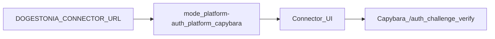

# 05 — Connector launch URL + Sign POC retire

**UTC:** `2026-11-27`  
**REQ:** [`../../requirements/10-wallet-address-proof-client.md`](../../requirements/10-wallet-address-proof-client.md) · lifetime [`../../requirements/11-sign-poc-debug-and-family-api-path.md`](../../requirements/11-sign-poc-debug-and-family-api-path.md)  
**Parent arch:** [`00-overview.md`](./00-overview.md) · residual POC [`04-poc-debug-surface-and-bootstrap-assist.md`](./04-poc-debug-surface-and-bootstrap-assist.md)  
**Adapter CORS/domain:** [`../08-identity-http-edge-on-host/04-connector-cors-and-challenge-origin.md`](../08-identity-http-edge-on-host/04-connector-cors-and-challenge-origin.md)  
**External:** [`../../../../doge-connector/docs/manuals/platform-integrator-guide.md`](../../../../doge-connector/docs/manuals/platform-integrator-guide.md)  
**Story:** WPROOF-10

**Lock (option A):** Retire experimental same-host Sign UI. **Keep** `/auth/challenge|verify`, Bearer, bootstrap, invite. Soft≠Live — this doc ≠ Live wire Present.

---

## 1. Verified as-is (Soft≠Live) — post WPROOF-10 P3

| Seam | Fact |
|------|------|
| Sign mint / page / POC assist | Module **Present** Soft residual — **retired** from default [`../../../host/server.js`](../../../host/server.js) compose (option A · `enableSignHttp` harness only) |
| WPROOF-08/09 POC debug | **Done** Soft — UI residual retired with `/sign/*` |
| `DOGESTONIA_CONNECTOR_URL` | Host wire **Present** — [`../../../host/connectorLaunch.js`](../../../host/connectorLaunch.js) · `GET /connector/launch` |
| `/auth/challenge|verify` | **Present** — survived Sign retire |
| Connector CORS + Origin domain | EDGE-11/12 **Done Soft≠Live** |

---

## 2. Target: launch via env

| Item | Rule |
|------|------|
| Env key | `DOGESTONIA_CONNECTOR_URL` (base URL of Connector, no secrets) |
| Launch query | `{DOGESTONIA_CONNECTOR_URL}?mode=platform-auth&platform=capybara` |
| Address | Human types expected EVM address **on Connector** (not in Capybara URL) |
| Entry | Capybara entry/redirect or documented operator link — Nested T in WPROOF-10 |

---

## 3. Target: retire Sign surface

| Remove (experimental) | Keep |
|-----------------------|------|
| `/sign/mint` · `/sign/{token}` · `/sign/client.js` · `/result` · client-event | `POST /auth/challenge` · `POST /auth/verify` |
| POC copy/bootstrap-on-Sign-page (WPROOF-08/09 UI) | `POST /auth/bootstrap` · invite HTTP · Bearer session |
| Terminal mint-driven Sign as primary UX | Soft docs honesty: historical A+B evidence retained; primary UX = Connector |

Wire removal in `signHttp.js` / `server.js` composition — Nested T WPROOF-10. Do not delete AUTH core.

---

## 4. Soft depends

| Soft | Why |
|------|-----|
| EDGE-11 · EDGE-12 | Browser Connector→Capybara blocked without CORS + domain/URI |
| WPROOF-08/09 Done | Retire **after** residual POC delivered (not reopen as product) |

---

## 5. Non-goals

- Connector allowlist / `CONNECTOR_PLATFORMS` (Connector ops)  
- Brand polish · money-sign · invent parallel auth  
- Epic tree materialize in docs-only wave  
- Claim Live Connector Pass from arch alone
