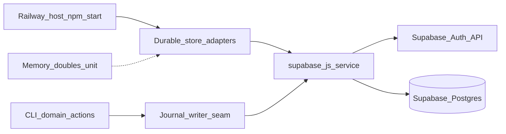

# Target technical architecture — Postgres family identity + journals (+ verified proofs)

**UTC:** `2026-11-27T17:23:20Z`  
**Profile:** `capybara` · focus `capybara/`  
**Slug:** `12-postgres-family-identity-and-journals`  
**Mode:** system package (this overview + siblings)  
**Packaging pack:** applied (Git ownership ≠ image packaging — reuse `@supabase/supabase-js` already required in host image for Auth; no new DB-driver dep)

## Context & inputs

| Input | Role |
|-------|------|
| [`../../requirements/12-postgres-family-identity-and-journals.md`](../../requirements/12-postgres-family-identity-and-journals.md) | Functional REQ (AC-P01…P09; Postgres primary; 1A proofs; 2B journals) |
| Story scope | **none** (0 STORY files in this Architect run) |
| Interview report | [`../../analysis/zeya888.target-tech-arch-interview-12-postgres-family-identity-and-journals-2026-11-27.md`](../../analysis/zeya888.target-tech-arch-interview-12-postgres-family-identity-and-journals-2026-11-27.md) |
| Sibling arch | [`../08-identity-http-edge-on-host/00-overview.md`](../08-identity-http-edge-on-host/00-overview.md) · [`../08-identity-http-edge-on-host/03-env-verify-coexistence-residual.md`](../08-identity-http-edge-on-host/03-env-verify-coexistence-residual.md) · [`../09-live-supabase-auth-port/00-overview.md`](../09-live-supabase-auth-port/00-overview.md) · [`../04-dual-auth-wallet-supabase-user/02-logical-contracts-and-session.md`](../04-dual-auth-wallet-supabase-user/02-logical-contracts-and-session.md) · [`../05-family-membership-parent-adds-child/00-overview.md`](../05-family-membership-parent-adds-child/00-overview.md) · [`../01-child-debt-accounting/01-journal-and-projection.md`](../01-child-debt-accounting/01-journal-and-projection.md) · [`../02-activity-payout-advance/01-journal-and-projection.md`](../02-activity-payout-advance/01-journal-and-projection.md) · [`../07-railway-family-host/00-overview.md`](../07-railway-family-host/00-overview.md) |
| Sibling REQ | [`04`](../../requirements/04-dual-auth-wallet-supabase-user.md) · [`05`](../../requirements/05-family-membership-parent-adds-child.md) · [`08`](../../requirements/08-identity-http-edge-on-host.md) · [`09`](../../requirements/09-live-supabase-auth-port.md) · [`01`](../../requirements/01-child-debt-accounting.md) · [`02`](../../requirements/02-activity-payout-advance.md) |
| Residual closed when Done | [`../../manuals/MEMBERSHIP-INVITE-REDEPLOY-RESIDUAL.md`](../../manuals/MEMBERSHIP-INVITE-REDEPLOY-RESIDUAL.md) (EDGE-08 / G8) |
| As-is | RAM `MembershipStore` / `InviteStore` · ephemeral challenge/bearer · NDJSON journals · Auth users durable · **PGDUR-01 migrations Present** under `capybara/supabase/migrations/` (Soft≠Live ≠ REQ-12 Done) |

**Split:** REQ-12 stays product-facing (what must survive redeploy; Postgres primary; proofs 1A; journals 2B). This package is **how** adapters, client seam, env, and cutover work — not NEW STORY/pkg/code/DDL bodies.

**Level:** Mixed functional+tech · packaging theme pack mandatory.

## Target technical architecture of the focus

Make **Supabase Postgres** the durable SoT for family identity, verified AddressProof audit, and domain journals. Keep pending challenge + Bearer (+ SignToken) ephemeral. Talk to tables via the **same** `@supabase/supabase-js` service client already used for Auth (not a separate `pg` driver). Inject Postgres-backed stores with the **same method surface** as today’s in-memory stores into `createAuthRuntime`; journal writers in core switch primary backend to Postgres while preserving `mock` | `gfl_reality`.

| Module (logical) | Responsibility |
|------------------|----------------|
| Durable Membership / Invite adapters | Same API as RAM stores; primary read/write Postgres |
| Verified proof writer | Persist AddressProof after successful verify; pending challenge stays RAM |
| Journal writer seam | activity / advance / debt → Postgres primary; mode preserved |
| `supabase-js` service client | Auth **and** `.from` / RPC table access; reuse `SUPABASE_URL` + secret key |
| Memory / test doubles | Unit inject only; production durable paths fail-closed without silent RAM SoT |
| Git-owned migrations | Schema applied to Supabase project (path TBD at implement — name ≠ create here) |

Siblings: [`01-components-and-client-seam.md`](./01-components-and-client-seam.md) · [`02-logical-data-and-contracts.md`](./02-logical-data-and-contracts.md) · [`03-runtime-env-packaging-verify.md`](./03-runtime-env-packaging-verify.md) · [`04-migration-coexistence-residual.md`](./04-migration-coexistence-residual.md).

## Ownership / contracts (interview locks)

| Artifact | Ownership |
|----------|-----------|
| Adapter / writer source | Git (`packages/core` + host wiring) |
| `@supabase/supabase-js` | Git lockfile + **image** (already REQ-09) — no new DB-driver dep |
| DDL migrations | Git-owned (exact path TBD implement); runtime does not invent schema |
| Supabase project / Auth users / Postgres data | External (Supabase) |
| Secrets | Railway env — reuse Auth keyMap; never Git / never `/health` |
| Challenge / Bearer / SignToken | Process memory (ephemeral — REQ 1A) |
| Legacy NDJSON files | Archive / residual read; not primary SoT after cutover |

## Runtime / packaging / verify / env / residual

See sibling **03**. Production start remains `npm start` (same host as REQ-07/08/09). CLI uses the same core journal writer seam.

## Coexistence with as-is

| Seam | Today | Target |
|------|-------|--------|
| Membership / Invite | RAM Maps | Postgres primary via same-surface adapters |
| Verified AddressProof | Response-only | Durable row (+ optional `familyId`) |
| Journals | NDJSON under `logs/capybara/` | Postgres primary; files = archive residual |
| Auth users | Supabase Auth | Unchanged (REQ-09) |
| Challenge / Bearer | RAM TTL | Unchanged ephemeral |

## Open questions

1. ~~Exact Git path for migrations~~ — **Locked** OP `2026-11-27`: `capybara/supabase/migrations/` + table names in [`../../analysis/proposal-pgdur-stories-2026-11-27.md`](../../analysis/proposal-pgdur-stories-2026-11-27.md) §4.  
2. RLS / grants detail on app tables (implement against Supabase project).  
3. Optional later NDJSON bulk import — **not** Accept gate (interview Q6).  
4. Exact SQL column types/indexes beyond field names from as-is stores — implement without inventing new business fields.

## Explicit “Not in this doc”

- NEW STORY / pkg / P3 / work-item lists  
- Product code / SQL migration file bodies  
- Pending challenge or Bearer durability  
- Address rebind · MCP/Skill · Express CRUD family API  
